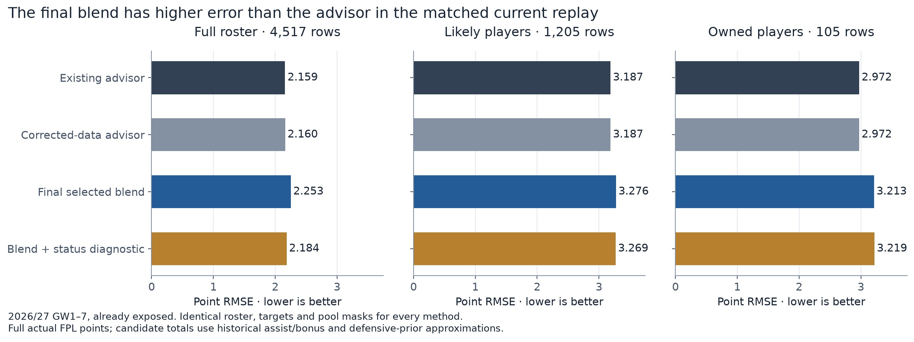
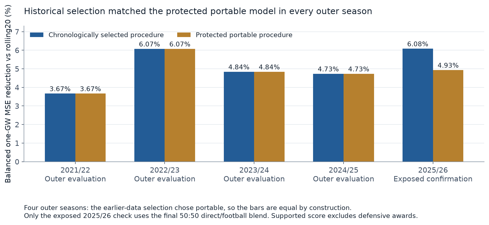
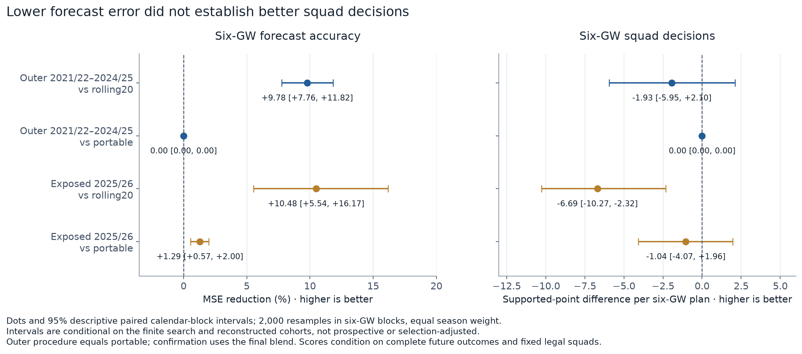

# The trained candidate is reproducible, but does not justify replacing the advisor

Evidence checkpoint: 31 October 2026, 21:25 UTC. This report covers the completed finite qualification study and local package validation. GitHub publication and hosted Linux checks are separate release steps.

**Retain the existing GitHub advisor as the primary forecast.** The new model is a useful, fixed research candidate that can run on demand, but the closest matched comparison does not show an improvement. On seven saved 2026/27 gameweeks, its point RMSE is **4.32% higher across the full roster**, **2.79% higher among likely players**, and **8.08% higher among owned players**. With the same owned squads and decision procedure, its choices score **392 points versus 422 for the advisor**.

Historical results are better against a simple rolling baseline: the procedure selected using earlier seasons reduces balanced one-gameweek MSE by **4.83%** and six-gameweek MSE by **9.78%**. However, that procedure selected the existing *portable learned model* in all four outer seasons. It therefore achieves **no improvement over that stronger protected reference**, and the declared strongest-reference improvement gate fails. These historical gains do not belong to the final exported blend.

The work completed **167 recipes across six development seasons: 1,002 recipe/season evaluations**, plus fixed confirmation, seed, model-export, scoring, horizon and portability checks. This is a substantial finite search, not a test of every possible model. Both 2025/26 and the seven current-season weeks had been examined previously; neither is a pristine holdout.

## The direct answer: how much better than the GitHub advisor?

On the exact comparison available, it is worse. Each method uses the same saved origin roster, fixture mapping, full actual FPL-point targets and fixed evaluation masks. “Likely” means the original advisor predicted at least 45 minutes; that mask is never redefined using the candidate. The owned pool contains the same 15 players in each of seven weeks. No raw squad identities are included in this public report.

| Method | Full-roster MAE / RMSE | Likely-player MAE / RMSE | Owned-player MAE / RMSE | Conditional lineup points |
|---|---:|---:|---:|---:|
| Existing advisor, frozen v1 | 1.134 / 2.159 | 2.334 / 3.187 | 2.377 / 2.972 | 422 |
| Advisor with separately corrected data | 1.135 / 2.160 | 2.333 / 3.187 | 2.376 / 2.972 | 422 |
| Final selected blend, raw policy | 1.350 / 2.253 | 2.378 / 3.276 | 2.508 / 3.213 | 392 |
| Same blend with predeclared status diagnostic | 1.181 / 2.184 | 2.369 / 3.269 | 2.513 / 3.219 | 392 |
| Matched player-gameweeks | 4,517 | 1,205 | 105 | Seven weekly decisions |

MAE is the mean absolute point error; RMSE gives larger errors more weight. Both are in FPL points and lower is better. The lineup score is a separate decision outcome, not another error metric.



The availability diagnostic uses the already-declared next-round status/chance rule. It improves full-roster error relative to the raw blend but still trails both advisor versions, and it does not repair the lineup deficit. It was not chosen or tuned from these seven outcomes. The raw final blend trails the frozen advisor in six of the seven full-roster MSE blocks and in six of the seven lineup blocks; the remaining lineup block is tied.

The candidate’s common rolling availability estimates are also weaker here. Full-roster appearance Brier score is **0.1794 versus 0.1217** for the advisor; 60-minute Brier score is **0.1533 versus 0.1092**; minute MAE is **25.63 versus 15.90 minutes**. Lower is better for all three. Its smaller aggregate point bias does not offset those errors or establish calibration.

This is a retrospective replay of the final selected procedure using weights trained on pre-2026/27 labels. Model selection and export happened later than the saved origins. Features are rebuilt separately at each origin using only earlier available observations, with a strict 48-hour lag. Later-captured stable player and club maps supply identity only; origin roles, club membership, flags, schedules and prices are retained. All seven snapshots have one fixture per club, so no double-gameweek totals were artificially split.

The same bounded legal lineup/captain/vice/bench optimizer and card-aware actual scorer are used for all methods. The results condition on those owned squads; they do not measure transfers, chips, transaction costs or season-long rank. The exact advisor comparison is confined to these seven exposed snapshots because equivalent broad historical advisor inputs are unavailable. [Aggregate current evidence](aggregates.json)

## What the historical study establishes

There are three distinct references:

- **Existing GitHub advisor:** the live rule/parameter procedure used in the exact current replay.
- **Portable learned reference:** the earlier learned-subtotal procedure, refitted using each fold’s earlier data. It is not the GitHub advisor.
- **Rolling20:** target-specific means over the last 20 observed opportunities, shrunk toward training-only position priors.

The first two development seasons, 2019/20 and 2020/21, set execution order. All recipes still receive the same six-season evaluation coverage. For each later season, component choices and the complete scoring procedure use only completed earlier seasons. The four outer seasons are 2021/22–2024/25. Each selected **portable**; that explains the exact equality to the protected portable reference rather than suggesting an independent tie between different models.



The primary historical target is **supported score**: the known scoring subtotal plus three times archived FPL assists plus archived bonus, excluding defensive-contribution awards. It retains historical assist/bonus definitions and origin positions. It is not relabelled exact current-rule FPL history. Actual historical total points are retained as a separately named secondary target.

The balanced one-gameweek criterion gives equal weight to the full and lag-defined likely pools, then equal weight to seasons. Relative to rolling20, the chronological procedure’s MSE reduction is **4.83%**, with a descriptive paired four-gameweek block interval of **4.22%–5.42%**. Relative to portable, the reduction is **0%**, since they are the same selected procedure in every outer fold. The predeclared 2% improvement requirement over the strongest protected reference therefore does not pass.

After all six development seasons, the locked final choice is **50% direct supported-score forecast plus 50% football-component assembly** (`blend_direct_football_050`). This choice was frozen before its new qualification scores on 2025/26, and was not changed afterward.

On that already-exposed 2025/26 check, the final blend lowers balanced one-gameweek MSE by **6.08% versus rolling20** and **1.21% versus portable**. Its full-pool RMSE is **1.893 versus 1.904** for portable; likely-pool RMSE is **2.910 versus 2.929**. These modest improvements are useful stability evidence, not proof that the blend would have been selected earlier or will beat the existing advisor now. The fixed second seed produces nearly the same balanced result, **0.93945 versus 0.93917** relative MSE; the primary seed is retained. [Historical, selection and seed evidence](aggregates.json)

## Six-week forecasts improve more than decisions

The six-gameweek check evaluates the **same complete procedure** with every feature vector frozen at the first origin. Later weeks do not receive intervening match outcomes. It uses the realised origin-club fixture calendar and only scores player horizons with complete observed outcomes. The four outer seasons contain **88,011 matched complete player-origin horizons**; they overlap and are not 88,011 independent trials.

| Comparison | Six-GW supported-score MSE reduction | Supported decision-point difference per complete six-GW squad plan |
|---|---:|---:|
| Outer chronological procedure vs rolling20 | 9.78% [7.76%, 11.82%] | −1.93 [−5.95, +2.10] |
| Outer chronological procedure vs portable | 0% [0%, 0%] | 0 [0, 0] |
| Exposed 2025/26 final blend vs rolling20 | 10.48% [5.54%, 16.17%] | −6.69 [−10.27, −2.32] |
| Exposed 2025/26 final blend vs portable | 1.29% [0.57%, 2.00%] | −1.04 [−4.07, +1.96] |

Brackets are saved 95% descriptive paired calendar-block intervals: 2,000 resamples in six-gameweek blocks, with equal season weight. They are conditional on the finite search and reconstructed cohorts, not prospective or selection-adjusted intervals. Positive accuracy reduction is better; positive decision difference is better. Fixed nonoverlapping-origin sensitivities are retained in the aggregate file; they do not convert this into independent prospective evidence.



These results do **not** establish better squad decisions. The historical one-week synthetic-squad checks are mixed as well: relative to rolling20, the earlier-selected procedure scores −90, +18, −45 and −26 points across the four outer seasons. In exposed 2025/26, the final blend scores 2,043 supported points versus 2,057 for portable and 2,040 for rolling20 over the same 38 weekly decisions. Actual historical full-point totals are separately 2,155, 2,177 and 2,144. These are fixed synthetic squads selected from origin metadata, not an ownership or transfer-policy backtest.

An aggregation defect initially stopped three horizon seasons. A versioned repair assigned zero **forecast mass** only where an independent origin-club calendar proved there were no fixtures. It did not invent zero outcomes: 25 affected cells across 24 origins retain unknown labels and remain unscored; the affected preselected squad week remains gated. The two successful seasons, model fits, selections and prepared inputs were preserved. [Horizon, decision and interval evidence](aggregates.json)

## What was searched and what remains outside scope

| Study dimension | Completed scope |
|---|---|
| Candidate catalogue | 167 fixed recipes: 164 main recipes plus three original portable anchors |
| Targets | 13: subtotal, assists, bonus, minute state, minutes, goals, supported score, historical points, clean-sheet points, save blocks, conceded blocks, negative costs and penalties saved |
| Families | Position priors and rolling means; regularized models, histogram boosting, LightGBM, CatBoost, ExtraTrees and XGBoost |
| Development coverage | All 167 recipes × six seasons = 1,002 evaluations; 204 are empirical prior/rolling evaluations, not learned estimator fits |
| Complete scoring procedures | 11 declared sums, direct models, football assemblies and fixed-weight blends |
| Features | 83 player-history columns; 129 with own/opponent context; 139 for the exact-target rolling sidecar |
| Controlled variations | 32 same-parameter base-only anchors; eight recent-four-season fits; eight three-year recency-weighted fits |
| Later checks | 29 locked primary confirmation evaluations, 29 fixed second-seed evaluations, 59 fold-export replays and 19 latest export tasks |
| Saved modern source panel | 320,931 source observations; target-specific support masks preserved |

The football assembly forecasts scoring events directly: appearance rewards, player goals, credited clean-sheet points, save/conceded blocks, deductions, penalties saved, assists and bonus. Save/conceded blocks are learned after applying the threshold rule to observed outcomes; the assembly does not take the floor of a mean count. Negative events remain signed in scoring. Expected components may be added without assuming independence, but their sum is not a calibrated joint score distribution.

This study does not cover every hyperparameter, neural architecture, injury or recovery model, transfer model, bookmaker feed or new data source. It does not optimize arbitrary component combinations or blend weights after seeing results. Recent-history variants change fitting rows or weights; they do not erase older feature history. Sparse source action fields and unavailable structural-zero periods retain explicit masks rather than being silently imputed as observed zeros.

The modern analysis is conditional on archived observed opportunity rows, not a certified eligible historical roster. Historical origins are reconstructed from realised kickoff schedules, and the strict event-time-plus-48-hours rule is an availability assumption rather than proof of publication or correction times. Current date-only histories use conservative UTC day end plus 48 hours. Future transfer/rescheduling uncertainty, historical position changes and current-rule assist/bonus differences remain material limits.

## Validation completed, with engineering and scientific conclusions separated

The saved evidence supports the following checks:

1. **Chronology and source integrity.** Frozen protocol, feature/data hashes, exact training/evaluation indices and earlier-season selection were checked. Target-gameweek histories are excluded, including companion fixtures. Future-label perturbation and mask tests cover leakage boundaries.
2. **Independent arithmetic.** 1,031 primary component records and 1,309 complete-score metric values were independently replayed. A separate standard-library current audit reconciles all 12 method/pool groups, 84 paired gameweek comparisons and 28 legal lineup scores; maximum metric disagreement is below 4×10⁻¹⁵.
3. **Saved models and fixed-origin horizons.** All 59 selected fold exports reproduce their saved evaluation forecasts within the fixed parity tolerance. Complete current saved-input inference replays exactly in a separate process. Horizon target, origin, coverage and legal decision outputs were checked independently.
4. **Calibration and stability.** Saved appearance/60-minute reliability bins, point calibration by position/history/prediction bands and fixed-seed sensitivity were inspected. Historical outer Brier scores are 0.1389 for appearance and 0.1258 for 60 minutes; the worse current availability comparison above remains visible. No post-result recalibration or best-seed selection was performed.
5. **Portable execution.** The 12-artifact runtime reproduces the selected lab procedure for 669 players and 4,014 fixture rows over GW10–15 from one saved capture. All 83/129/139 feature matrices, CSV/JSON values and exact fresh-process outputs are checked. A relocated copy and its replay process both deny Python-level reads/imports from the original workspace. A 32-row actual-model offline fixture has zero numeric difference locally.

The relocation guard is a Python-level check, not an operating-system sandbox or a guarantee about native-library file access. At this report checkpoint, clean Linux execution and a fresh hosted official-API run are still separate pending release checks. Passing those engineering checks would establish portability; it would not reverse the scientific recommendation.

The carried budget through local pipeline completion is **21,305.50 seconds, or 5 hours 55 minutes**, against the original 24-hour ceiling. It includes prior work, conservative preparation charges, failed attempts, operational recovery and validation. Final report/publication work is not yet included in that checkpoint. This is metered cumulative campaign time, not total human/agent authoring time or the sum of all parallel estimator CPU seconds. The finite catalogue completed without spending the remaining allowance on unplanned tuning. [Validation and budget evidence](aggregates.json)

## How to use the result from GitHub

The deliverable is a **fixed model that runs once when requested**. There is no seasonal Mac monitor, automatic retraining or background scheduler. After release validation, Claude Code or another Python environment can install the pinned Python 3.12 dependencies and run:

```bash
fpl-forecast run --output-dir runs/weekly-forecast
```

The command captures fresh public FPL inputs, forecasts the next six available gameweeks from one origin, saves fixture/gameweek/six-gameweek CSVs and JSON, verifies replay, then exits. Offline inference accepts an already saved compatible capture. A manually triggered GitHub Actions workflow is a separate supported delivery route once its hosted checks pass; it is not a cron schedule. Ordinary Claude chat can read published CSV/JSON, but reading model files from GitHub does not execute them.

Model weights and the selected blend stay fixed while fresh past-match inputs update the features. The runtime is bound to 2026/27 and its evidenced club map; it should fail rather than silently carry that map into another season. The default output is explicitly named `approximate_current_rule_expected_total`: supported score plus twice a lag-only defensive-hit prior. Exact current-rule expected total remains unavailable. The status diagnostic is separate, applies only to the next gameweek, and does not assume a future recovery date.

Publish this candidate with the evidence and keep the existing advisor as primary. This completes the requested finite research and produces a reproducible comparison model; it does not justify claiming a stronger weekly decision system.

## Reproducible public evidence

[aggregates.json](aggregates.json) contains only aggregate tables, intervals, counts, source-relative identifiers and SHA-256 bindings. It includes no user account IDs, individual owned squads, raw captures, home-directory paths or secrets. Source hashes refer to preserved local study records; those raw records are not bundled into this public report.

[build_figures.py](build_figures.py) regenerates the three figures from that aggregate file using Matplotlib and NumPy, with no model loading, API calls or research database. Run it from this folder with `python build_figures.py`. PNGs are embedded above; matching SVGs are in [figures/](figures/). Values retain full precision in the aggregate evidence; the narrative rounds for readability.
